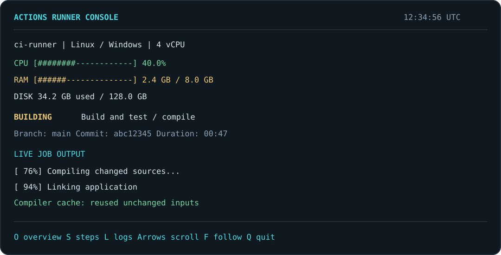

# Actions Runner Console

[](https://github.com/sheazywi/actions-runner-console/actions/workflows/test.yml)

A local dashboard for **GitHub Actions self-hosted runners on Linux and Windows**. See CPU, RAM, disk space, the current job, observed steps, and actual job output from your machine or VM console.



Python 3.10+, standard library only. No web server, browser, GitHub API token, GPU, desktop environment, or cloud service required. Works with a normal terminal, Linux serial console, or Windows Server Core console.

## What you get

- Overview, chronological steps, and a scrollable live-log view.
- Job name, branch, commit, duration, last result, and runner process status.
- Rotating local logs: five files, up to 10 MiB each.
- Linux systemd and Windows Task Scheduler installers.
- Standard-account operation. Administrators only install services, hooks and permissions.
- Reversible hooks that preserve unrelated runner environment settings.

This is a dashboard for an **already configured GitHub Actions runner**. It does not create VMs, register runners, activate Windows, or install your project's compiler.

## Try it without installing a service

Clone this repository onto the runner machine, then run as its normal build account:

```bash
git clone https://github.com/sheazywi/actions-runner-console.git
cd actions-runner-console
python3 run.py --runner-dir /opt/actions-runner --data-dir "$HOME/.local/state/runner-console" collect
```

In a second terminal, use the same paths with `show` instead of `collect`. For Windows, use `python`, a runner path such as `C:\actions-runner`, and a data directory writable by your build account. A collector alone can show process status, steps and available logs; install the job hooks for reliable job metadata.

You may also `pip install .` and use `runner-console`. This project is published here on GitHub; no PyPI release is required for the direct launcher.

## Linux installation

Requires systemd, Python 3.10+, and an existing non-root runner account:

```bash
sudo bash installers/install-linux.sh \
  --runner-dir /opt/actions-runner --user runner
```

Restart the GitHub runner service **when idle** so it loads the new hooks, or explicitly add `--restart-runner` during installation.

To take over selected VM consoles, explicitly request it:

```bash
sudo bash installers/install-linux.sh \
  --runner-dir /opt/actions-runner --user runner \
  --tty tty1 --tty ttyS0 --take-over-console
```

This replaces the selected getty/login console with the dashboard, remembers the previous state, and leaves other terminals alone. Without the TTY options, open the dashboard manually:

```bash
python3 /opt/actions-runner-console/run.py \
  --config /opt/actions-runner-console/config.json show
```

Services: `actions-runner-console.service` and optional `actions-runner-console-tty1.service` / `actions-runner-console-ttyS0.service`. Source is root-owned; state and logs are owned by the build account.

## Windows installation

Run in administrator PowerShell. Use a dedicated **standard account** that already runs your GitHub runner:

```powershell
$credential = Get-Credential "$env:COMPUTERNAME\runner"
.\installers\install-windows.ps1 -RunnerDirectory C:\actions-runner `
  -Credential $credential -GrantBatchLogonRight -StartAtLogon
```

`-GrantBatchLogonRight` explicitly adds only that account to **Log on as a batch job**, preserving other accounts' existing rights. Omit it if the right is already assigned. Domain policy may override local grants. The password is passed to Windows Task Scheduler for protected storage; the installer never writes it into project files, a JSON config, or runner hooks.

The collector starts at boot as the supplied account with limited privileges. `-StartAtLogon` opens a dashboard when that account signs in; it does not enable automatic sign-in. No PowerShell profile is executed or modified by the installer. Sign-in is not required for builds or background logging.

Default paths:

| Purpose | Windows | Linux |
|---|---|---|
| Program | `C:\Program Files\ActionsRunnerConsole` | `/opt/actions-runner-console` |
| State/logs | `C:\ProgramData\ActionsRunnerConsole` | `/var/lib/actions-runner-console` |
| Collector | `ActionsRunnerConsoleCollector` task | `actions-runner-console.service` |

If another tool already owns your job hooks, installation stops. Integrate them manually, or explicitly pass `-ReplaceHooks` / `--replace-hooks`; prior hook paths are saved for uninstall.

## Controls

| Key | Action |
|---|---|
| O | Overview |
| S | Observed job steps |
| L | Larger log view |
| Up / Down, Page Up / Page Down | Scroll history |
| F | Follow newest output |
| Q | Exit the manual dashboard (a dedicated Linux console service restarts it) |

Times are UTC. “Observed steps” does not claim that every step succeeded; consult the actual output and final job result.

## Faster repeat builds

The dashboard **does not clean your workspace, delete build output, or evict compiler caches**. Your workflow controls that. See [persistent build caching](docs/caching.md) for trusted-runner examples, configuration separation, invalidation and before/after measurements.

Caching cannot guarantee a particular build time. A cold cache, a changed compiler, or a widely included header still requires compilation.

## Logs and trust

The collector mirrors runner-generated job-level pages under `_diag/pages`, which GitHub's runner has already masked. It reads only step names from worker diagnostics; it does not dump raw diagnostic logs or read runner credentials. It uses no GitHub API token.

Masking is not a guarantee that all application output is safe. Keep state/log directories private and avoid printing secrets in jobs. Use disposable GitHub-hosted runners for untrusted pull requests. The dashboard does not enforce your repository's trust policy.

The page/worker format is an internal runner detail, not a stable public API. This initial release was derived from dashboards used with runner 2.338.2. Very short jobs may finish before a local page is observed; GitHub's Actions log remains the complete record.

## Uninstall

```bash
sudo bash installers/uninstall-linux.sh /opt/actions-runner-console
```

```powershell
.\installers\uninstall-windows.ps1
```

Services/tasks are removed, and only this tool's hook settings are restored. Linux restores the login consoles it took over. Program files, log history, and Windows batch-logon rights are retained for review; other tasks may use that account right. Restart the GitHub runner when idle after uninstalling hooks.

## Development

```bash
python -m unittest discover -s tests -v
python run.py --version
```

Tests cover concurrent Windows file replacement, masked-page ingestion, metadata filtering, reversible hooks, collector locking and platform metrics. CI runs on Linux and Windows with Python 3.10 and 3.14.

MIT licensed. Contributions and bug reports are welcome.
